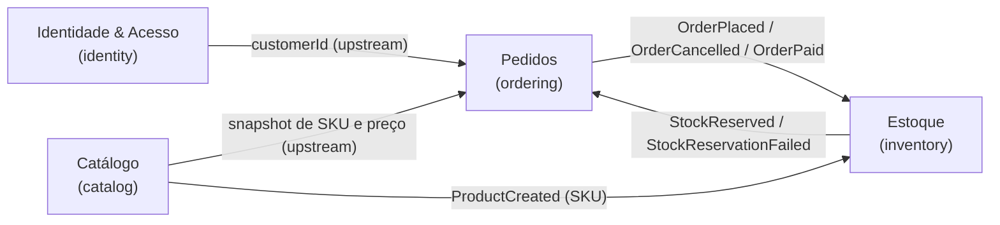

# Context map da Loja Ágil

| Relação              | Tipo                                       | Como se integra                                                                                    |
| -------------------- | ------------------------------------------ | -------------------------------------------------------------------------------------------------- |
| Identidade → Pedidos | Upstream/Downstream                        | Pedidos guarda apenas o `customerId`; nunca acessa a entidade `User`                               |
| Catálogo → Pedidos   | Upstream/Downstream (Anticorruption Layer) | Pedidos consulta o catálogo por uma porta (`ProductCatalog`) e copia SKU e preço para o item       |
| Pedidos ↔ Estoque    | Parceria por eventos de domínio            | Estoque reage a eventos de pedido e publica o resultado da reserva                                 |
| Catálogo → Estoque   | Upstream/Downstream                        | Ao criar um produto, o estoque cria o `StockItem` correspondente com saldo zero                    |
| `shared`             | Shared Kernel                              | Blocos de construção comuns (`Entity`, `ValueObject`, `DomainError`…); não conhece nenhum contexto |
