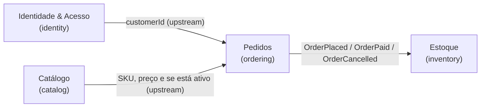

# Context map da Loja Ágil

| Relação              | Tipo                                       | Como se integra                                                                                                                                  |
| -------------------- | ------------------------------------------ | ------------------------------------------------------------------------------------------------------------------------------------------------ |
| Identidade → Pedidos | Upstream/Downstream                        | Pedidos guarda apenas o `customerId`; nunca acessa a entidade `User`                                                                             |
| Catálogo → Pedidos   | Upstream/Downstream (Anticorruption Layer) | Pedidos consulta o catálogo pela porta `ProductCatalog`; o `ProductCatalogAdapter`, em `src/integration`, traduz o `Product` e o preço é copiado |
| Pedidos → Estoque    | Upstream/Downstream por eventos de domínio | O Estoque reage aos eventos de pedido na mesma transação (ADR 0011): reserva tudo ou nada, dá baixa e devolve                                    |
| Catálogo e Estoque   | Sem integração direta                      | O item de estoque nasce na primeira entrada do SKU; um SKU sem estoque conta como zero unidades na reserva                                       |
| `shared`             | Shared Kernel                              | Blocos de construção comuns (`Entity`, `ValueObject`, `DomainError`, `EventDispatcher`…); não conhece nenhum contexto                            |
| `integration`        | Camada de integração                       | Liga os contextos: adaptadores e inscrições nos eventos. Conhece os contextos; nenhum deles a conhece                                            |
